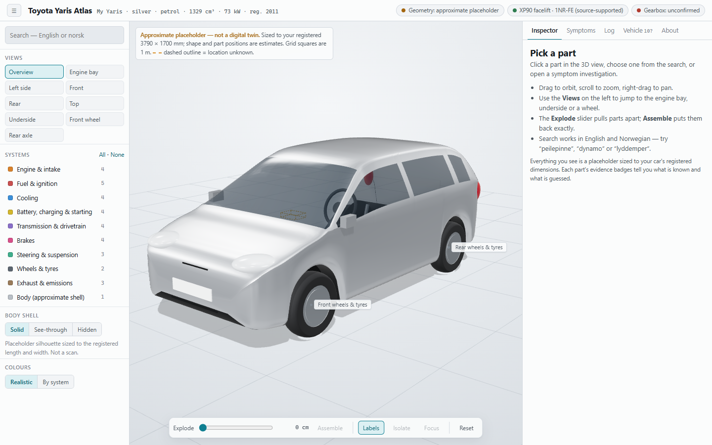

# Toyota Yaris Atlas

An interactive 3D guide to one specific car: a silver 2011-registered Toyota Yaris 1.33
petrol. It helps you understand what the parts do, roughly where they are, think through a
symptom, and keep a log of what you observe and what gets done.

> **Approximate, not a digital twin.** The 3D model is a placeholder sized to the car's
> registered length and width. Part positions are estimates. Every fact in the app carries
> a badge: owner-supplied, source-verified, generic, approximate or unknown.
> The symptom tool is a structured way to observe, **not a diagnosis**.



## What it does

* **3D viewer:** orbit, zoom and pan. Click or hover to select and highlight, with labels,
  a smooth explode slider that restores exactly, nine camera views, a see-through or hidden
  body shell, and realistic or per-system colours.
* **34 components** across engine and intake, fuel and ignition, cooling, battery/charging/
  starting, transmission, brakes, steering and suspension, wheels and tyres, exhaust, and
  body. Each has its function, approximate location, related parts, symptoms, safe
  checks, evidence status and sources.
* **Search in English and Norwegian.** "peilepinne", "dynamo", "lyddemper",
  "kjolevifte" (with or without ø) all work.
* **Vehicle profile:** your registration data, the variant most likely matching it
  (with sources), and open questions you can answer by looking at the car.
* **Symptom investigation** for seven situations: won't crank, cranks but won't start,
  rough running, warning light, overheating, noise/vibration, braking. You get follow-up
  questions, possibilities with the evidence for and against each, next observations,
  and stop-driving guidance where it matters. OBD codes are entered manually; the app
  never connects to the car.
* **Log** of observations and maintenance, stored in your browser, with JSON
  export/import.

## Setup (Windows, first time)

You need **Node.js** (the JavaScript runtime that builds and serves the app). Blender
is optional.

1. Install Node.js LTS (22.18 or newer; tested with 24). Either download the "LTS" installer from
   <https://nodejs.org>, or in PowerShell run:

   ```powershell
   winget install OpenJS.NodeJS.LTS
   ```

   Close and reopen your terminal afterwards, then check with `node --version`.
2. Open a terminal **in this folder**. In VS Code: *Terminal → New Terminal*.
3. Install the dependencies (once, or after pulling changes):

   ```powershell
   npm install
   ```

4. Start the app:

   ```powershell
   npm run dev
   ```

   Open <http://127.0.0.1:5173> in Edge or Chrome. Press `Ctrl+C` in the terminal to
   stop it.

### Your private identifiers (optional)

The registration number and VIN live in `config/vehicle.local.json`. That file is
**ignored by Git**, so it is never committed. A redacted template,
`config/vehicle.example.json`, is committed instead. The local dev server shows the
values in the Vehicle panel, masked until you click *Show*. They are never stored in the
browser, never included in log exports, and never bundled into a build. The app works
without the file.

## Checks

| Command | What it does |
|---|---|
| `npm test` | Unit tests: data integrity, explode maths (no drift), search, log export/import, symptom logic, GLB mapping |
| `npm run build` | Type-check, production build into `dist/`, then the privacy scan |
| `npm run audit` | Starts the production build and drives it in Edge/Chrome. It checks selection, hover, search, system toggles, reset, explode/restore, symptom flows, OBD entry, persistence, export/import, masking, missing/corrupt/partial GLB fallbacks and dark mode at 1280×720. Screenshots go to `test-output/`. If Blender is installed, it also round-trips a GLB through it |
| `npm run check` | All of the above, in order |
| `npm run check:privacy` | Only the scan for private identifiers in committed files and `dist/` |

## 3D models and Blender

The placeholders can be replaced one part at a time with GLB files exported from
Blender, using stable IDs such as `battery` or `front-wheels`. Start with **About →
Download placeholder GLB for Blender**, then follow
**[docs/BLENDER-GLB-WORKFLOW.md](docs/BLENDER-GLB-WORKFLOW.md)**. A helper script,
`blender/yaris_atlas_tools.py`, adds a *Yaris Atlas* panel to Blender (import, validate,
export). Nothing needs installing.

Candidate downloadable models, and their licences, are listed in
[docs/ASSET-SOURCING.md](docs/ASSET-SOURCING.md). None has been downloaded or bundled.

## Documentation

* [docs/ARCHITECTURE.md](docs/ARCHITECTURE.md): how the code is organised
* [docs/VEHICLE-RESEARCH.md](docs/VEHICLE-RESEARCH.md): what is known about the car,
  with sources and open questions
* [docs/BLENDER-GLB-WORKFLOW.md](docs/BLENDER-GLB-WORKFLOW.md): scale, axes, naming,
  export
* [docs/ASSET-SOURCING.md](docs/ASSET-SOURCING.md) and
  [docs/ASSET-LICENCES.md](docs/ASSET-LICENCES.md): third-party models and attribution

## Deliberately not included

Part numbers, torque settings, fluid specifications, fuse assignments, wiring,
service intervals and exact component locations. They need documentation that matches
your exact variant: the owner's manual, or Toyota service information.

## Safety

Checks suggested by the app are observational: engine off and cool unless a step says
otherwise. The app never suggests working near a running engine, opening a hot cooling
system, going under a car on a jack, or doing airbag or fuel-system work yourself. If
brakes, steering, smoke or a red warning lamp are involved, stop somewhere safe and get
professional help.

## Licence

Not chosen yet. Decide before making the repository public.
